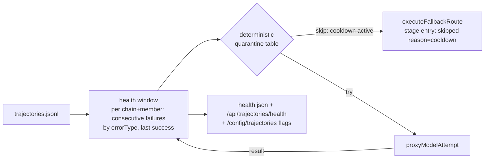

# Plan: Fallback-system logic corrections (health-aware chain execution) + backlog

## 1. Problem

The fallback chain does its job — every request eventually gets answered — but it pays for
resilience with latency: with just two smoke requests the chain walked 34 dead stages in ~50
seconds before a working member answered, and the same dead members are re-tried (and
wraparound-revisited) on every single request. The operator wants the fallback logic corrected
so a provider/model that is "no longer working right" is detected and stops burning the chain,
plus a prioritized plan for the other defects the new trajectory log exposed.

## 2. Anchor Facts

- The escalating wraparound plan for 17 eligible members contains **152 stages** per request
  (escalating threshold: revisit the top of the chain after 2, then 3, … failures) —
  established from `src/execution-plan.ts` (`buildEscalatingWraparoundPlan`) and the live
  record `chain.planStageCount: 152` in `~/.config/local-router/trajectories/trajectories.jsonl`.
- Two real `local-router/fallback-models` requests (2026-11-12, dev port 11436) each burned
  35 stage attempts (34 failed, 42–53 s) before `cursor/auto` answered — established from
  `GET /api/trajectories` on the smoke server.
- 7 of 17 chain members currently `never_answers`: `cline-deepseek-deepseek-v4-flash-free`
  and `zenmux-glm-5.3-free` (`upstream_http_auth` ×14 each), `xiaomi-mimo-mimo-v2.6-pro`
  (`upstream_http` ×12), `antigravity-gemini-3.7-flash` (`upstream_http_auth` ×10),
  `zai-glm-5.3-flash` (`upstream_http_auth` ×8), `cursor-deepseek-v41-flash-1017`
  (`upstream_http_auth` ×6), `cursor-grok-4.7` (`upstream_http` ×4) — established from
  `GET /api/trajectories/health` (flags `never_answers` + `recent_error_spike`).
- `upstream_http_auth` on a keyed provider means the stored key is rejected upstream; retrying
  within the same request cannot heal it — established from `AttemptFailure.errorType` mapping
  in `src/index.ts` (`proxyModelAttempt`).
- Models dropped **before** planning (`activeFallbackModels` key-presence filter, disabled
  toggles) and capability-filtered models are now recorded per request in
  `chain.excludedTargets` with reasons — established from `src/index.ts`
  (`executeFallbackRoute`, chain snapshot) and `tests/trajectories.test.mjs`.
- Pre-existing failing test (fails identically on main's untouched build):
  `tests/custom-providers.integration.test.mjs` "custom provider CRUD, chat routing, and delete
  guards" expects upstream echo `/ok:vendor-model-1/` but gets `ok:test-vendor-demo` —
  established from running the test on both the feature worktree and main.
- Cost-first chain ordering (`free -> subscription -> paid -> unknown`, access path outranks
  tier label) is an operator decision (2026-11-09) implemented in `src/fallback-topology.ts` —
  established from `.agents/memories/MEMORY.md` and the module header. The latency problem is
  dead members, not the ordering.
- The trajectory log is the new observability of record: `~/.config/local-router/trajectories/
  trajectories.jsonl`, `GET /api/trajectories*`, page `/config/trajectories` — established from
  the merge `f9e352c` and live smoke on :11434/:11436.

## 3. Plan

### Goals

- A chain member with repeated non-retryable failures stops being executed within the same
  request and across requests for a bounded cooldown, deterministically (code decides, not the
  model), and the skip is recorded as `excludedTargets`/stage entries so the trajectory stays
  honest.
- `upstream_http_auth` failures surface immediately (health warning + trajectory flag), never
  consume wraparound revisits, and name the stale key.
- The custom-provider model resolution bug is fixed and its integration test goes green.
- The operator can see, per chain, "who is dead and why" from `/config/trajectories` and
  `health.json` without reading raw JSONL.

### Non-goals

- No chain reordering: cost-first ordering is a settled operator decision; this plan makes it
  fast, not different.
- No telemetry sharing / cross-machine shipping of trajectories (local-only by contract).
- No Decisions-API trajectory capture (its own `attempts` provenance already exists).

### Constraints and invariants

- "Decisions live in code": cooldown thresholds, quarantine rules, and skip conditions are
  deterministic constants/config in TypeScript — never inferred by a model at runtime.
- `router-settings.json` remains the authoritative chain source; any health-derived state is
  derived and re-derivable, never written back into the chain file.
- A skipped-for-health member MUST appear in the record with its reason (the trajectory log's
  honesty contract); fail closed on any unrecorded skip.
- Skip/health state lives in memory + the trajectory store; no new persistent mutable state
  that can drift from reality (stale quarantine must expire).

### Proposed architecture

- A small in-memory `FallbackHealthRegistry` (fed by the existing `TrajectoryTracker.finish`
  hook) answers one question per member: `mayAttempt(chainId, model, errorTypeHistory)`.
  Rules (proposed, to be confirmed in §4): `upstream_http_auth`/`upstream_http_payment_required`
  quarantines after **1** failure until key change or 30 min; retryable classes
  (`upstream_http_rate_limit`, `upstream_http_unavailable`, `upstream_http`) quarantine after
  **3** consecutive failures for 5 min; any success clears the member. Wraparound revisits only
  re-enter quarantined members when the whole chain is otherwise exhausted.

### Interfaces and data

- `src/trajectories.ts` — no schema change; `analyzeTrajectories` window feeds the registry.
- `src/index.ts` — `activeFallbackModels()` / `fallbackStagePreflight()` consult the registry;
  skip entries carry `reason: 'cooldown:<errorType>'` in `excludedTargets`.
- `src/execution-plan.ts` — `buildEscalatingWraparoundPlan(models, opts?)` gains an optional
  `skipRevisitsFor: (model) => boolean` (before: only `models[]`; after: plan omits wraparound
  revisits of quarantined members; primary order untouched).
- `~/.config/local-router/health.json` — new `chainHealth: { routeId: { dead: [...],
  degraded: [...] } }` block (additive).
- Env: `LOCAL_ROUTER_HEALTH_COOLDOWN_AUTH_MIN` (default 30), `LOCAL_ROUTER_HEALTH_COOLDOWN_RETRY_MIN`
  (default 5), `LOCAL_ROUTER_HEALTH_DISABLE=1` opt-out.

### Files and symbols

- `src/health-registry.ts` (new) — `FallbackHealthRegistry`: `recordOutcome()`, `mayAttempt()`, `snapshot()`.
- `src/index.ts` — `executeFallbackRoute`, `activeFallbackModels`, `fallbackStagePreflight`,
  `handleEmbeddingRequest` (same consult).
- `src/execution-plan.ts` — `buildEscalatingWraparoundPlan` revisit gating.
- `src/expert-logs.ts` — `onFinish` idempotence guard (double-call would double-append the
  expert log; the trajectory side already guards).
- `src/routes/config-api.ts` + `src/ui/pages/layout.ts` — surface quarantine state in
  `/api/trajectories/health` and the page.
- `tests/custom-providers.integration.test.mjs` failing case — root-cause in
  `POST /api/provider-models/:provider/models` upsert / `findProviderModel` resolution order.
- `tests/health-registry.test.mjs` (new) + `tests/execution-plan.test.mjs` additions.

### Alternatives considered

| Alternative | Why rejected |
|---|---|
| Persist quarantine to disk | Stale state outlives key fixes; the registry is re-derivable from the trajectory log, and expiry must be automatic |
| Shorten the wraparound plan globally | Hurts the legitimate recovery case (subscription-window resets) that the wraparound exists for; targeted revisit-gating keeps it |
| Move dead members down the chain (reorder) | Violates the settled cost-first operator decision; ordering is policy, health is execution |
| Auto-remove dead members from `router-settings.json` | Chain file is operator-authored truth; execution-time skipping keeps intent auditable |

### Risks and mitigations

| Risk | Mitigation |
|---|---|
| Quarantine hides a recovered member (transient outage) | Short bounded cooldowns; any success clears immediately; `LOCAL_ROUTER_HEALTH_DISABLE=1` kill-switch |
| Skipping reduces resilience (fewer members actually tried) | Quarantine only fires on repeated non-retryable evidence; exhausted-chain paths can still force-try quarantined members as a last pass |
| Health window disagrees with the operator's view | The page shows quarantine reasons next to the same trajectory rows the operator reads |
| Custom-provider fix disturbs working resolution paths | The integration test asserts the exact before/after echo; full `npm test` gate |

## 4. Clarifications

### 4.1 Quarantine thresholds

- **Question:** After how many failures, and for how long, does a member stop being executed?
- **Options:** 1. (Recommended) per-error-class as in §3 (auth/payment = 1 strike, 30 min; retryable = 3 strikes, 5 min) — matches "auth doesn't heal by retrying"; 2. uniform 3 strikes / 5 min for all classes — simpler, keeps hammering auth-dead members twice more per request; 3. operator-configured only — most control, no sensible default.
- **Selected:** 1 — per-error-class. Operator confirmed 2026-11-12: key-rejected / out-of-funds = 1 strike, 30 min cooldown; rate-limit / unavailable = 3 consecutive strikes, 5 min cooldown; any success clears immediately. Usage-error (`upstream_http_invalid_request`) joins the 3-strike/5-min class (may be request-specific, e.g. tools/context; must not hide a member from unrelated requests) — decided in code, stated here.
- **asked:** operator
- **resolved by:** operator (2026-11-12)

### 4.2 Last-pass behavior when the whole chain is quarantined

- **Question:** If every member is quarantined and the chain would 502, should the router force-try quarantined members anyway?
- **Options:** 1. (Recommended) yes — a stale answer beats a 502, and the attempt is logged; 2. no — fail closed with the quarantine report in the error body; 3. only retryable-quarantined members, never auth-dead ones (they cannot answer).
- **Selected:** 1 — force-try quarantined members as a last pass (chain order, one attempt each, logged with `reason: forced_after_quarantine`). Operator confirmed 2026-11-12.
- **asked:** operator
- **resolved by:** operator (2026-11-12)

### 4.3 Error-class visibility (added 2026-11-12 from operator request)

- **Question:** How should usage errors and API-key out-of-funds errors surface on the trajectories page for user and agent review?
- **Selected:** four stable error classes per chain member — `key_rejected`, `out_of_funds`, `usage_limit`, `usage_error` — with counts, last-seen, and flags on `/config/trajectories` and in `/api/trajectories/health` JSON. Operator confirmed 2026-11-12. This requires fixing `classifyHttpFailure` (T0): today `402` maps to `upstream_http_quota` (the `payment_required` branch is dead code), `429` maps to `quota` before `rate_limit` is reachable, `413` is mislabeled a rate limit, and body text `balance|insufficient|billing` (out-of-funds) collapses into quota — so the page cannot tell "out of funds" from "usage limit" at all.
- **asked:** operator
- **resolved by:** operator (2026-11-12)

## 5. Todos

- [x] **T0** Fix `classifyHttpFailure` misclassifications and add `errorClassFor(errorType)` → `key_rejected` / `out_of_funds` / `usage_limit` / `usage_error` / `other`: `402` → `upstream_http_payment_required`, `429` → `upstream_http_rate_limit` (body `insufficient_quota|balance|billing|credit|out of funds` → `payment_required`), `413` → `upstream_http_invalid_request`, body `quota|rate limit|usage limit` → `upstream_http_quota`, body `api_usage_error|unknown model|context_length` → `upstream_http_invalid_request`.
  - from: §4.3 | done when: each status/body class maps to the right errorType and the four display classes | verify: `node --test tests/health-registry.test.mjs` (classification cases)
- [x] **T1** Implement `src/health-registry.ts` with the §4.1 thresholds (key_rejected/out_of_funds 1 strike × 30 min; usage_limit/unavailable/usage_error 3 consecutive strikes × 5 min; any success clears) and wire `recordOutcome` into `TrajectoryTracker.finish` call sites.
  - from: §3 | done when: registry reflects live outcomes | verify: `node --test tests/health-registry.test.mjs`
- [x] **T2** Gate `executeFallbackRoute` / `activeFallbackModels` / `fallbackStagePreflight` (chat + embeddings) on `mayAttempt`, recording cooldown skips in `excludedTargets`.
  - from: §3 | done when: a quarantined member is skipped with a recorded reason | verify: `node --test tests/health-registry.test.mjs tests/trajectories.test.mjs`
- [x] **T3** Gate wraparound revisits in `buildEscalatingWraparoundPlan` so dead members are not re-entered mid-request.
  - from: §3 | done when: plan omits revisits of quarantined members | verify: `node --test tests/execution-plan.test.mjs`
- [x] **T4** Fix the custom-provider model resolution bug (`ok:test-vendor-demo` vs `/ok:vendor-model-1/`).
  - from: §2 | done when: `tests/custom-providers.integration.test.mjs` fully green | verify: `node --test tests/custom-providers.integration.test.mjs`
- [x] **T5** Surface `chainHealth` in `health.json`, `/api/trajectories/health`, and `/config/trajectories` (quarantine badges) plus per-member error classes (§4.3: `key_rejected` / `out_of_funds` / `usage_limit` / `usage_error` counts, last-seen, flags).
  - from: §3, §4.3 | done when: page shows dead/degraded members with reasons and error classes; JSON carries the same | verify: live smoke + screenshot on :11436
- [x] **T6** `onFinish` idempotence guard in `src/expert-logs.ts`.
  - from: §3 | done when: double `onFinish` logs one expert entry | verify: unit test or smoke
- [ ] **T7** (operator action — blocked: needs new key material from providers) Record operator key action for the key-rejected members — live history now names them precisely via error classes: `cline-deepseek-deepseek-v4-flash-free` (key_rejected ×18), `zenmux-glm-5.3-free` (×14), `antigravity-gemini-3.7-flash` (×10), `openrouter-ernie-5.5-flash-preview-free` (×4): refresh via `pqc-secrets set`, then confirm `GET /api/trajectories/health` stops flagging them.
  - from: §2 | done when: auth flags clear on fresh trajectories | verify: live smoke

## 6. Verification

- `npm test` — full suite green except any failure proven pre-existing on main.
- `node --test tests/health-registry.test.mjs tests/trajectories.test.mjs tests/execution-plan.test.mjs` — all green.
- Live smoke on :11436 with one deliberately dead chain member — member skipped after the threshold, record shows `reason: cooldown:*`, request latency drops (target: <5 s when only members after the first healthy one are dead).
- `GET /api/trajectories/health` — quarantine state visible; `/config/trajectories` screenshot shows badges.

## 7. Open Decisions

- Whether embeddings chains get the same quarantine consult or stay simple (T2 says yes — confirm cost/benefit once chat-path data exists) — settled by observing embedding-chain failure patterns in `trajectories.jsonl` after a week.
- Whether the 152-stage wraparound ceiling itself should shrink once quarantine works (fewer wasted stages) — settled by comparing `planStageCount` vs `stageCount` across live trajectories.

## 8. Implementation notes (2026-11-12)

Shipped as `90295d6` (`feat/fallback-logic-corrections`), merged to `main` as `056e13d`;
see `.agents/tasks/TASK.2026-11-12.fallback-logic-corrections.md` for the worktree journal.

- **T1 wiring deviates from §3**: `recordOutcome` is wired eagerly at stage resolution
  (`recordStageOutcome` in `executeFallbackRoute` and the embedding loop), not at
  `TrajectoryTracker.finish` — outcomes must land before the wraparound re-enters the member
  later in the same request, which is T3's actual goal. The trajectory log stays observational.
- **§4.2 refined**: the force-try tail only covers quarantined members the request never
  attempted. A member that failed mid-request carries the freshest possible evidence;
  re-hammering it is what the cooldown exists to stop.
- **T2 placement**: quarantine gating lives in the execution paths (`executeFallbackRoute`,
  `fallbackStagePreflight`, the embedding candidate split), deliberately NOT in
  `activeFallbackModels` — presentation/availability must keep showing the configured chain
  (the documented "shrinking chain vs missing key" hazard in `candidateAvailability`).
  Cooldown skips are recorded as stage entries with `skipReason: cooldown:<errorType>`
  (the goals allow "excludedTargets/stage entries"); `excludedTargets` keeps its
  pre-planning semantics (disabled_toggle / no_configured_key / capability filters).
- **T4 root cause** was not the guessed upsert/resolution order: `localLoopbackRegisteredModels`
  rebuilt rows with `id = defaultPresentedModelName(...)` and `providerCatalogModels`'
  unconditional `byKey.set` overwrote the custom-editor override, so `findProviderModel`
  missed the presented alias and the raw `split('/')` path forwarded the alias upstream.
  Fixed with override precedence in the loopback row.
