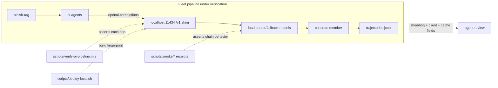

# Plan: Tooling hardening — agent contracts, trajectories/tracing, fallback correctness, pi pipeline

## 1. Problem

The recent feature work (fallback quarantine, max caching, catalog federation, dual toggles) shipped
against tooling that drifted or was never built: the plans contract cites artifacts this checkout
does not have, deploy/verify rituals and smoke checks live in throwaway /tmp scripts that are gone,
the trajectory log does not say explicitly when the `local-router/fallback-models` chain alias sheds
to a concrete member (agents can mistake it for an outage), and the ainish-rag → pi agents →
localhost:11434 → `local-router/fallback-models` pipeline — which now powers the fleet's reviews —
has no single command proving it works end to end or that pi's mirrored model metadata still matches
the shim. The operator wants the tooling brought up to the standard the features assume: contracts
honest and enforced, traces legible to agents, fallback behavior provable, the pi pipeline verifiable.

## 2. Anchor Facts

- The plans-tooling contract is `.agents/plans/llms.txt` (fleet version deployed 2026-11-14 15:50;
  local-router's copy was a stale older scheme) — established from `diff` of the two checkouts'
  copies and the `ainish-sync.log` deploy batch.
- Three contract artifacts are MISSING while AGENTS.md/the contract cite them as live:
  `bin/context-packet.sh`, `.agents/templates/worktree-merge.md`, `scripts/commit-identity-guard.sh`
  — established from `test -e` audit against the AGENTS.md and plans/llms.txt references.
- The pi/hermes pipeline wiring is recorded in `.agents/tasks/TASK.2026-11-12.pi-hermes-ollama-defaults.md`:
  pi `~/.pi/agent/models.json` (provider `ollama`, `http://localhost:11434/v1`,
  `api openai-completions`, one model `local-router/fallback-models`, metadata **mirroring** the
  shim's live `/v1/models` entry) + `settings.json` defaults; hermes via the named
  `providers.local-router` block (the `ollama` provider name resolves to the real Ollama on :11435
  and 404s — a documented trap).
- Chain-alias shedding is real but implicit: `local-router/fallback-models` is an alias that sheds to
  a concrete member per request (live records show winners like `xiaomi-mimo-mimo-v2.6-pro`); the
  trajectory record carries `presentedModel` + winner but no explicit shedding marker — established
  from `src/trajectories.ts` (TrajectoryRecord shape) and the trajectory-traces task record.
- Trajectory/health system of record: `src/trajectories.ts` (TrajectoryRecord, `analyzeTrajectories`,
  error classes), `src/health-registry.ts` (quarantine), `/api/trajectories*`, `/config/trajectories`
  — established from the 2026-11-12 fallback-logic task record (commits daf1ad8/f9e352c onwards).
- Fallback behavior is verified only by throwaway smokes (16/16 and 11/11 checks) whose scripts were
  deleted after the merges — established from the task records' verification sections.
- Deploy has twice served a stale build because `lsof -ti :11434 | head -1` killed the wrong PID of
  a multi-PID port — established from TASK.2026-11-12.dual-toggles-model-identity.md notes and the
  memory entry.
- Caching capability probes used a pqc-secrets-pipe pattern (`bin/pqc-secrets.darwin-arm64 export |
  node <probe>`) and found the fastino key retired and the opencode key expired; the probe script
  is gone and the rows' re-measurement remains blocked on operator keys — established from
  TASK.2026-11-12.max-caching-everywhere.md.
- Suggestion debts still open: `scripts/verify-decisions.mjs` one-command transport receipt
  (2026-10-31-suggestions) and a `gate-baseline` note pinning the chronic red axes
  (2026-11-03-suggestions) — established from those files.

## 3. Plan

### Goals

- Every artifact the contracts cite exists and is exercised; plan/record verification runs as one
  command (`plans-doctor`).
- The trajectory log states chain-alias shedding explicitly, attributes pi/ainish-rag calls to their
  client, and reports per-stage cache observability — so agents can review errors and fallback
  behavior without folklore.
- Fallback behavior (quarantine skips, cooldown reasons, force-try, wraparound revisit gating, error
  classes) is provable from committed `scripts/smoke/` receipts, not memory.
- One command proves the fleet pipeline: ainish-rag → pi → `http://localhost:11434/v1` →
  `local-router/fallback-models` → chain winner → trajectory record, including the pi metadata-vs-
  shim drift check and an interactive latency/cost line.
- Deploy is scripted and fingerprint-verified (no stale-build class), and the caching probe +
  decisions verify + gate baseline are repo tools.

### Non-goals

- No chain reordering or new fallback semantics (execution correctness is audited, not redesigned).
- No cross-machine telemetry (trajectories stay local-only per contract).
- No UI redesign beyond what trace/health surfaces need.

### Constraints and invariants

- Secrets never in argv, files, logs, or fixtures — probes take key material only via the
  pqc-secrets stdout pipe (AGENTS.md secrets rule).
- Trajectory honesty contract: every skipped stage is recorded with its reason; new fields are
  additive and bump `schema_version`.
- One writer per mutation boundary; `router-settings.json` keeps the read-merge-write discipline.
- Plans artifacts follow the enhanced `.agents/plans/llms.txt` (this repo copy carries the 2026-11-14
  enhancements: `[~]` partial marks, section order, done-with-operator-blocker, reference integrity).
- "Decisions live in code": drift checks, thresholds, and pass/fail verdicts are deterministic code.

### Proposed architecture

- `scripts/` becomes the tooling surface: `deploy-local.sh`, `probe-caching.mjs`,
  `verify-decisions.mjs`, `verify-pi-pipeline.mjs`, `smoke/*.mjs` + one runner, `plans-doctor`.
- Trajectory schema v2 (additive): an explicit shedding marker (alias → concrete winner), per-stage
  cached-token observability where the wire reports usage, and verified `client` attribution.
- The missing contract artifacts are created in their cited locations and covered by `plans-doctor`.

### Interfaces and data

- `TrajectoryRecord`: additive fields only (`schema_version` bump) — shedding marker, per-stage cache
  usage; existing readers (page, `/api/trajectories*`) must stay compatible.
- `scripts/verify-pi-pipeline.mjs`: reads `~/.pi/agent/models.json` + `/v1/models`; posts one chat via
  `local-router/fallback-models`; asserts trajectory record fields; prints latency/cost/verdict JSON.
- `plans-doctor`: runs the plans/llms.txt verification commands + reference-integrity check; exit
  non-zero on drift.

## 4. Clarifications

- None pending. Scope settled by the operator 2026-11-14 ("the tooling also includes the proper
  updates to the trajectories, tracing, and ensuring our fallback tooling works right; ainish-rag now
  uses `pi` agents that need to be powered by the localhost:11434 local-router fallback-models
  model") — `asked: operator`.

## 5. Todos

- [ ] **A1** Sync this checkout to the deployed rules contract (`ainish-rules-sync --headless`):
  plans/llms.txt + templates + `-team.md` ledger naming + live-board adoption; grandfather existing
  plans; new plans use `{date}-{HH}-{slug}.md`.
- [ ] **A2** Create `bin/context-packet.sh` (reads plan `status` + unchecked §5 boxes for bootstrap).
- [ ] **A3** Create `.agents/templates/worktree-merge.md` (the merge journal format AGENTS.md mandates).
- [ ] **A4** Create `scripts/commit-identity-guard.sh` (post-commit identity enforcement, rule 4).
- [ ] **A5** Create `scripts/plans-doctor` running the contract's verification + reference integrity;
  wire as `npm run verify:plans`.
- [ ] **A6** Feed the 2026-11-14 `.agents/plans/llms.txt` enhancements upstream to the rules source so
  the next `--rules` deploy carries them (partial marks, section order, done-with-blocker, reference
  integrity) — `asked: resolved from code` that deploy-managed files are clobbered on sync.
- [ ] **C1** Trajectory schema v2: explicit chain-alias shedding marker (presented alias → concrete
  winner) in `TrajectoryRecord` + page/API rendering; bump `schema_version`; keep readers compatible.
- [ ] **C2** Per-stage cache observability: capture cached/usage tokens per stage where the wire
  reports them (stream usage already requested per policy), visible in stage timelines.
- [ ] **C3** Client attribution: pi/ainish-rag calls carry `x-local-router-client` (or derived UA) and
  land in `trajectory.client`; fix the capture path where they don't.
- [ ] **C4** `docs/trajectories.md`: the agent-facing guide to reading the log/API (records, flags,
  error classes, health, shedding semantics) — the "agents can properly review errors" surface.
- [ ] **D1** Promote the deleted smoke checks into `scripts/smoke/` receipts (quarantine skip +
  cooldown reasons + force-try + error classes; model identity + archive federation; caching wire
  shape) with one runner and a `npm run smoke` alias.
- [ ] **D2** Fallback-tooling audit under pi load: `GET /api/trajectories/health` + `chainHealth`
  correctness on live traffic; measure `planStageCount` vs `stageCount` across records (the
  fallback-logic plan §7 open decision) and record the verdict.
- [ ] **D3** pi metadata drift guard: `verify-pi-pipeline` compares `~/.pi/agent/models.json`'s
  mirrored chain metadata (context/maxTokens/thinking map) against the shim's live `/v1/models`
  entry and reports drift.
- [ ] **E1** `scripts/verify-pi-pipeline.mjs`: end-to-end proof of ainish-rag → pi → /v1 →
  `local-router/fallback-models` → chain winner → trajectory record (client + chain + shedding
  fields asserted), with an interactive latency/cost line (fallback-logic target: chain latency
  bounded when only tail members are dead).
- [ ] **E2** `npm run verify:tooling` aggregate: plans-doctor + smoke runner + verify-decisions +
  verify-pi-pipeline — the one command a deploy or a new chat runs first.
- [ ] **B1** `scripts/deploy-local.sh`: kill-all-PIDs on :11434, rebuild, kickstart, fingerprint the
  served build (a known API marker), report served-vs-built commit; replaces the twice-broken manual
  ritual.
- [ ] **B2** `scripts/probe-caching.mjs` (promoted from the throwaway): pqc-secrets-pipe probes for
  markers/retention/sticky keys; run on key rotation; its output replaces `[INFERENCE]` caching notes
  (fastino/opencode re-measurement once valid keys exist — operator action).
- [ ] **B3** `scripts/verify-decisions.mjs` (2026-10-31 suggestion): probe + typed batch + chat guard
  + forced-fallback rerank as one JSON receipt.
- [ ] **B4** `gate-baseline` note (2026-11-03 suggestion): pin the chronic red axes so gate cards show
  only new regressions.

## 6. Verification

- `npm run verify:tooling` green end to end on the live router (plans-doctor, smoke receipts,
  verify-decisions, verify-pi-pipeline).
- `npm test` full suite green; trajectory schema v2 covered by unit tests (shedding marker, cache
  fields, client attribution) and the page/API stay reader-compatible.
- `verify-pi-pipeline` prints a passing verdict with a trajectory record id that a reviewer can open
  on `/config/trajectories` and see the shedding marker + client + error classes.
- `deploy-local.sh` round-trip: deploy, fingerprint matches, no stale PID survives.
