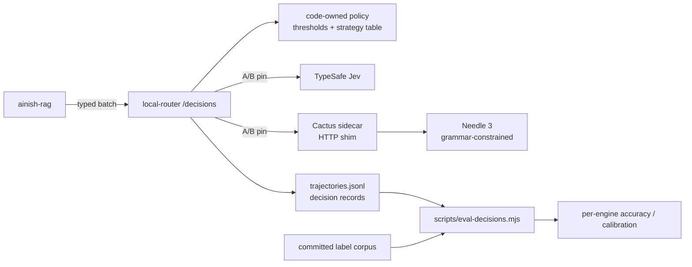

# Plan: Decision engine — code it out, or adopt Cactus/Needle as the decision model?

## 1. Problem

The router now has a trustworthy logging substrate: trajectory schema v2 records every chat call with
its full stage timeline, an explicit chain-alias shed marker, and resolved client attribution. That
prompted the next question — should the *decision* layer get the same treatment, and specifically:
**do we code decisions out ourselves, or use the Cactus small-model system as the decision model?**

There is a live decision layer already: the router proxies TypeSafe Jev (`typesafe/jev-1.14`) over
OpenRouter, serves it at `/api/alpha/decisions`, `/v1/decisions`, `/decisions`, and fails over between
providers on a translated dialect. ainish-rag sends five typed judgments in one parallel batch
(`needs_retrieval`, `domain_target`, `context_freshness`, `query_specificity`, `modality_preference`)
and then derives `retrieval_strategy` + `candidate_pool_size` **in deterministic Rust code**. A second
batch (`is_faithful`, `faithfulness_score`, `completeness_score`) gates output.

So the architectural answer to "code or model" is already settled by AGENTS.md non-negotiable 6
("Decisions live in code. Models may classify, rank, or draft; thresholds, allowlists, side effects,
and refusals are deterministic code"). The genuinely open question is different and narrower:
**is Jev the right classifier, is it calibrated, and can we prove either way?** Today we cannot —
decision calls are the one model-call class with no durable record, and no labelled corpus exists to
measure against. This plan builds the measurement first, then decides on evidence.

## 2. Anchor Facts

- **Decision calls write no trajectory.** `rg "new TrajectoryTracker" src/` returns exactly two sites,
  both in `src/index.ts` (chat at :8189, embeddings at :7994). Nothing under `src/decisions/`
  references `TrajectoryTracker`. — established from source.
- **Decision telemetry is an in-memory ring buffer of 25.** `DecisionTelemetryEntry` in
  `src/decisions/service.ts:108` holds only `{at, route, requested_model, canonical_model, provider,
  dialect, status, ms, attempts, error?}` — transport facts, no answers, no probabilities, no
  question ids, no cost. `TELEMETRY_LIMIT = 25` and there is no `fs.` write in the file. It is lost on
  restart. — established from source; confirms the `recent` block returned by
  `GET /api/decisions/status`.
- **No decision ever appears in the trajectory log.** `grep -c "typesafe\|jev"` over
  `~/.config/local-router/trajectories/trajectories.jsonl` returns 0. — established from the live log.
- **The model supplies probabilities; the code supplies the decision.** `NoulAnswer.noul` is a
  probability of yes in 0..1; `ChoiceAnswer` carries `probabilities`; `ScoreAnswer.score` is a
  probability-weighted expected level. ainish-rag then hard-codes thresholds
  (`JEV_NOUL_YES`, `retrieval_probability >= 0.5`) and a deterministic strategy table in
  `derive_retrieval_strategy`. — established from `src/decisions/types.ts` and
  `ainish-coder/src/rag/src/decision.rs:124`.
- **A non-model path already exists and is crude.** `route_local` falls back to `starts_with("hello")`,
  `contains("pqc")`, and similar keyword tests when Jev is unreachable. It is a liveness fallback, not
  a comparable classifier — it cannot be the thing we "solidly code out" without a real label set.
  — established from `decision.rs:1148`.
- **Cactus is a different *shape* of model, not a smaller Jev.** Needle 3 is a 29–121M-parameter
  grammar-constrained tool-caller: text in, a JSON tool call out, with a byte-level grammar compiled
  from your schemas so the call is always well-formed. It has no free-text output and no probability
  distribution over options — it emits `function_calls` plus one calibrated `confidence` in [0,1],
  and refusals are an **empty** `function_calls`. — established from the repo's `llms.txt`
  (fetched 2026-11-18, Apache-2.0, 14.8k stars, pushed 2026-11-17).
- **Cactus's OpenAI-compatible HTTP server cannot run on this host for the large model.**
  `cactus-mlx server` requires Apple silicon + macOS 26+ + Python 3.12+ and its adapter supports only
  Nemotron-H CQ checkpoints; the documented example is `nemotron-3.5-120b-cq`. This machine has
  macOS 27.2.1 / arm64 / Python 3.15.2 / **18 GB RAM**, so a 120B checkpoint is not feasible.
  Needle, Whistle, and Mirage use a *native* engine with no HTTP server of their own. — established
  from the README and `sysctl hw.memsize`.
- **The decision provider layer is genuinely pluggable.** `catalog.ts` says so explicitly: "Adding a
  provider is one entry plus a dialect in `dialects.ts`; the transport, fallback, discovery, and
  status surfaces pick it up automatically." Per-provider URL/model overrides and a
  `LOCAL_ROUTER_DECISION_ORDER` pin already exist, so an A/B against a new engine needs no new
  plumbing. — established from `src/decisions/catalog.ts` and `docs/decisions.md:207`.
- **The router is Node/TypeScript; Cactus is Python.** There is no Python in the router's runtime
  path (the only `.py` files are under `.agents/skills/pqc-secrets/tests/`). Any Cactus integration is
  therefore a *sidecar process* behind an HTTP shim, never an in-process dependency. — established
  from `package.json` and a repo-wide `find`.
- **Smaller Cactus checkpoints do exist** (LFM2-350M/700M/1.2B/2.6B/8B-A1B, Qwen3-0.6B/1.7B,
  gemma-3-270m/1b, Qwen3.5-0.8B/2B, functiongemma-270m), so an 18 GB host is not excluded from
  Cactus generally — only from its documented server path. — established from the Hugging Face
  `Cactus-Compute` org listing.

## 3. Plan

### Goals

- Give decision calls the same durable, agent-readable record chat calls already have, so every
  future claim about decision quality is checkable from the log rather than from memory.
- Establish a labelled evaluation set for the judgments ainish-rag actually asks, so "is Jev good
  enough" and "is Needle good enough" become measurable rather than argued.
- Reach a written, evidence-backed verdict on Jev vs. Cactus/Needle, including the cases where the
  honest answer is "keep Jev and fix the code around it".

### Non-goals

- Replacing Jev by default in this task. This plan measures; the replacement is a separate decision.
- Making the LLM own thresholds, allowlists, or refusals — that would violate non-negotiable 6.
- Running a 120B model, or adding a GPU/MLX dependency to the router.
- Changing ainish-rag's `derive_retrieval_strategy` contract.

### Constraints and invariants

- Decisions stay deterministic code; any model is a *scorer* feeding a code-owned threshold table.
- Secrets via `pqc-secrets` at runtime; `CACTUS_API_KEY` is only relevant for the hosted fine-tune
  path and must never be printed or committed.
- New trajectory fields are additive and bump `schema_version`; v2 records stay readable.
- A sidecar is a process boundary: it must fail closed (unavailable sidecar = Jev path, never a
  silent "all decisions are yes").
- Evaluation must be reproducible offline from a committed label file, not re-derived per run.

### Proposed architecture

- **Phase 1 — observability (no model choice implied).** Decision records join the trajectory log
  with the answers, probabilities, question ids, and a cost/duration rollup, so we can answer "what
  did the model actually say" historically.
- **Phase 2 — corpus.** A committed, human-labelled set of real prompts with expected answers for the
  five routing judgments plus the three faithfulness judgments.
- **Phase 3 — evaluation harness.** One script scores any engine against the corpus: accuracy per
  question, calibration (Brier / reliability bands), latency, and refusal rate.
- **Phase 4 — Cactus spike behind a shim.** Only if Phases 1–3 show Jev is weak on a *specific*
  question class does the sidecar get built, and then only for that class.
- **Phase 5 — verdict.** A written record of which engine wins which question, with numbers.

Each phase is independently useful and independently abandonable. Phase 1 and 2 are worth doing even
if the answer is "keep Jev forever", which is the likely outcome.

### Interfaces and data

- `TrajectoryRecord` gains an optional `decision` block (additive, `schema_version` 3):
  `{ answers: Record<id, {type, value, probabilities?}>, questionIds, usage, costTotal }`.
  A chat-only reader ignores it.
- `scripts/eval-decisions.mjs`: `--engine jev|needle|local --corpus <jsonl> --json`, emitting
  `{engine, perQuestion: {accuracy, brier, n}, latencyP50, latencyP95, refusals}`.
- `.agents/eval/decisions/golden.jsonl`: one line per case — `{prompt, expected: {questionId: value},
  notes}`. Committed, so a regression is a diff.
- Cactus sidecar (Phase 4 only): `scripts/cactus-shim.mjs` exposing
  `POST /v1/decisions` in the router's canonical shape, mapping each question to a tool schema.

## 4. Clarifications

- Scope is "review the whole system and plan", not "implement the replacement" — `asked: operator`
  (2026-11-18 message).
- The question is explicitly framed as "can we solidly code this out ourselves OR use cactus" — so
  the plan must compare, not campaign for either — `asked: operator`.
- AGENTS.md non-negotiable 6 governs and is not under review: a model may classify/rank/draft,
  thresholds and refusals stay in code. This plan therefore evaluates *classifiers*, not
  *decision-makers*. — `asked: resolved from code`
- "Proper logging" as the premise is partly false for decisions: chat and embeddings are logged,
  decisions are not. Phase 1 closes that gap rather than assuming it is closed. — `asked: resolved from code`
- **SUPERSEDED IN PART (2026-11-18, later the same day).** The operator settled the question this plan
  was framed to answer: local-router will **not** be offline-only, it **will** carry decision-model
  tooling for hard-to-code provider failure states, and the immediate work is failure routing plus
  usage/failure-rate handling rather than a Cactus comparison. The live work is now
  `2026-11-18-10-failure-classification-routing` (code-first classification) and
  `2026-11-18-11-usage-window-and-failure-rate` (windows, persistence, auto-disable, decision-model
  assist). This plan stays open only as the record of the Cactus evaluation; its Phase 1-2
  (decision records + label corpus) are still prerequisites for judging ANY decision model, including
  Jev, so they are not wasted. — `asked: operator`

## 5. Todos

- [ ] **P1.1** Emit a `decision` block in the trajectory log for every decision call (answers,
  question ids, probabilities where the dialect supplies them, latency, cost), bumping
  `schema_version` to 3 additively. Verify: a live `/decisions` call produces a record whose
  `decision.answers` matches the HTTP response.
- [ ] **P1.2** Persist decision telemetry beyond the 25-entry in-memory ring (append-only JSONL beside
  the trajectory log), so provider/latency history survives a restart. Verify: restart the router and
  show the prior entries are still readable.
- [ ] **P1.3** Tag ainish-rag's decision calls with `x-local-router-client: ainish-rag` so decision
  records attribute to their caller the way chat records now do. Verify: `client` is `ainish-rag`, not
  `unknown`, on a real route call.
- [ ] **P2.1** Build `.agents/eval/decisions/golden.jsonl` from ≥100 real prompts spanning the five
  routing judgments, human-labelled with the expected answer per question and a `notes` rationale.
  Verify: every line validates against a schema test; label distribution is not degenerate (no
  question where one answer exceeds 90%).
- [ ] **P2.2** Add a small set of adversarial cases: the self-contained prompts `route_local` already
  special-cases, plus prompts where retrieval is tempting but wrong. Verify: `route_local`'s accuracy
  on the corpus is measured and recorded, giving a genuine coded-out baseline.
- [ ] **P3.1** `scripts/eval-decisions.mjs` scoring any engine over the corpus: per-question accuracy,
  Brier score for noul, exact-match for choice, MAE for score, plus latency percentiles and refusal
  rate. Verify: running it twice on the same engine is deterministic; a deliberately corrupted corpus
  line makes it fail closed rather than silently skip.
- [ ] **P3.2** Record a Jev baseline receipt in `.agents/audit/`, including which provider answered and
  how often failover fired, so the baseline is attributable.
- [ ] **P2.3** Decide per-question whether Jev's probabilities are *calibrated* (reliability bands),
  not merely accurate. Verify: a reliability table in the receipt; a question whose bands are
  inverted is called out as unusable for thresholding.
- [ ] **P4.1** (Conditional — only if P3 shows a weak question class) Cactus spike: install
  `cactus-compute`, run Needle 3 locally, and prove one judgment maps to a grammar-constrained tool
  call. Verify: a recorded transcript showing `function_calls` + `confidence` for a real prompt, on
  this host, with no network dependency at inference time.
- [ ] **P4.2** (Conditional) `scripts/cactus-shim.mjs` presenting the canonical decision shape over
  Needle, with a fail-closed contract: a sidecar error returns a transport error, never a default
  answer. Verify: shim down → the router still answers via Jev; no silent fallback to a stub answer.
- [ ] **P4.3** A/B run on the corpus: Jev vs. Needle per question, including refusals and the
  confidence-threshold sweep, so we see the accuracy/escalation trade-off rather than one point.
- [ ] **P5.1** Write the verdict into this plan's §8 with the numbers, naming per question which
  engine wins and whether the win is large enough to justify a sidecar process.
- [ ] **P5.2** If the verdict is "keep Jev": file the observed weaknesses as
  `.agents/suggestions/` items (e.g. a question that should be split, a threshold that should move)
  rather than leaving them as folklore.

## 6. Verification

- `npm run verify:decisions` stays green — the existing transport receipt is not regressed by any of
  this.
- A live decision call appears in the trajectory log with answers matching the HTTP response, and
  survives a router restart.
- `scripts/eval-decisions.mjs` reproduces the same numbers on two consecutive runs against the same
  engine and corpus.
- The coded-out baseline (`route_local`) has a measured accuracy on the corpus, so "code it out" is
  compared against a number rather than an assumption.
- Any Cactus claim in §8 is backed by a transcript from this host, not by the upstream README.

## 7. Open Decisions

- **Corpus provenance and size.** Hand-labelling 100+ real prompts is operator time. Alternative:
  bootstrap labels from Jev itself, then have the operator correct a sample — faster, but it biases
  the corpus toward the incumbent. Needs an operator call before P2.1.
- **Which questions are in scope.** Routing (5 questions) and faithfulness (3) are both candidates.
  Faithfulness is higher-stakes and harder to label; routing is cheaper and higher-volume. Starting
  with routing is recommended, but this is a scope choice.
- **Whether a sidecar process is acceptable at all.** A Python sidecar in the router's path adds an
  operational dependency to a loopback-only Node service. If Phase 4 is reached, this needs an
  explicit yes.
- **What "good enough" means.** A numeric bar (e.g. per-question accuracy ≥ the coded-out baseline on
  every question, and Brier ≤ 0.20) has to be agreed before Phase 3 runs, or the verdict becomes
  post-hoc.
