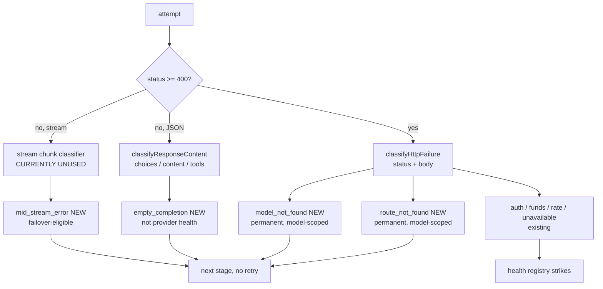

# Plan: Correct failure classification so the fallback chain routes on what actually failed

## 1. Problem

The operator's directive (2026-11-18): ensure the fallback system routes correctly on real failures
for every model and logic path, preferring code everywhere, and using Jev only where a failure is
genuinely ambiguous.

Auditing the classification path against 221 live trajectory records found that routing itself works —
every failure advances the chain, quarantine fires after the right strike counts, and recovery was
observed live. The defect is one layer earlier: **the classifier that decides *what* failed is
lossy**, and three of its gaps produce materially wrong behaviour. The largest single bucket,
`upstream_http` (202 failures), is a catch-all hiding at least three structurally different causes
that each deserve a different response — and two of them are currently treated as retryable provider
faults when they are really "this route does not exist" and "this model produced nothing".

The point of this plan is not to add a model. It is to make code correct first, and then attach Jev
only to the residue that code provably cannot separate.

## 2. Anchor Facts

- **Routing already works.** Every failed stage falls through to the next member: the chain loop has
  no early-return on error, and `recordStageOutcome` is called for both answered and failed in the
  fallback path. Quarantine was observed working end to end for
  `cline-deepseek-deepseek-v4-pro-paid`: 23 `upstream_http_unavailable` failures, then 13 consecutive
  `cooldown` skips, then 12 answers — i.e. strikes, quarantine, expiry, recovery. — established by
  replaying `~/.config/local-router/trajectories/trajectories.jsonl`.
- **The catch-all is the biggest bucket.** Across 221 records, failed stages by type:
  `upstream_http` 202, `upstream_http_auth` 126, `upstream_http_invalid_request` 70,
  `upstream_http_unavailable` 23, `upstream_http_rate_limit` 7, `proxy_runtime` 2. — established from
  the live log.
- **`upstream_http` hides three distinct causes**, confirmed by status and body: 93 are **404**
  ("Route POST:/v1/chat/completions not found" from cursor/openrouter), 59 are **200** with
  `finish_reason: length` and empty content, and 50 are **502**. — established from stage `status`
  plus `providerErrorPreview`.
- **404 is not classified at all.** `classifyHttpFailure` handles 402/401/403/429/5xx/400/413/422 and
  falls through to `upstream_http`. A 404 "route not found" — a permanent, model-or-path-specific
  condition — is therefore treated exactly like an unknown transient fault. Verified by running the
  classifier's exact logic on the real bodies: `404 -> upstream_http`. — established from
  `src/index.ts:6741` and a direct replay.
- **A 200 with no `choices` array is treated as success.** In `classifyResponseContent`,
  `if (!Array.isArray(parsed?.choices) || parsed.choices.length === 0) return 'generated'` — so a
  provider answering 200 with `{"id":"x"}` (no choices) or with unparseable HTML both classify as a
  generated answer, and the chain accepts them. Verified by replaying the function:
  `no choices -> generated`, `unparseable html -> generated`, `empty choices -> generated`.
  — established from `src/index.ts:6809` and a replay.
- **Streaming failures cannot trigger mid-stream failover.** `classifyStreamChunkAsError` is defined
  at `src/index.ts:6842` and **never called** (`rg` finds exactly one occurrence, the definition).
  Content classification is also gated on `!isStreamRequest && isJsonResponse`, so a stream that
  starts fine and then emits an error event is passed through to the client rather than failing over.
  — established from source.
- **Health treats "no usable answer" as a provider-health signal.** A 200-with-empty-content is
  normalized to `errorType: 'upstream_http'`, which is in `EVIDENCE_FAILURE_TYPES`, so a reasoning
  model that burns its budget and returns nothing accrues strikes and gets quarantined — a
  model-configuration problem being recorded as a provider outage. — established from
  `src/health-registry.ts:60` and the `instant_error` path at `src/index.ts:7536`.
- **Jev is not needed for any of the three.** Each is decidable from data already in hand: an HTTP
  status, the presence of a `choices` array, and whether content/tool-calls are non-empty. This is
  precisely the "code first" case the operator described. — established from the evidence above.
- **Existing seams are the right ones.** `classifyHttpFailure` is a pure function over
  `(status, bodyText)`; `classifyResponseContent` is pure over `(body, isStream, status)`; error types
  are a closed union in `AttemptFailure`; and `errorClassFor` maps type → triage class. Extending any
  of them is local and unit-testable. — established from source.

## 3. Plan

### Goals

- Every observed failure class resolves to a specific, correct error type — no meaningful failure is
  left in the `upstream_http` bucket.
- Permanent conditions (route missing, model absent) are not retried or quarantined as if transient.
- "Answered with nothing usable" is recorded as its own class and routed without poisoning provider
  health for a model-configuration fault.
- Streaming errors fail over instead of passing through.
- Jev is introduced only for a residue that survives all of the above, and only with a measured
  justification.

### Non-goals

- Reordering the fallback chain or changing quarantine strike counts / cooldowns (they work).
- Adding a provider or changing provider policy.
- Replacing the `errorClassFor` triage vocabulary.
- Any Jev work before Phase 3 shows a residue that code cannot resolve.

### Constraints and invariants

- New error types are additive members of the `AttemptFailure['errorType']` union; existing strings
  keep their meaning so historical trajectories stay readable.
- `EVIDENCE_FAILURE_TYPES` is a deliberate allowlist: a new type must be consciously added or it
  silently stops affecting quarantine. Every new type gets an explicit decision recorded.
- Classification stays pure and synchronous (status + body in, type out) so it is unit-testable
  without a network.
- Fail closed: an unclassifiable body keeps `upstream_http` rather than being guessed into a
  specific class.
- Decisions live in code: thresholds and classes are code; Jev may only *label* a residue for
  offline analysis, never gate a live routing decision in this plan.

### Proposed architecture

- **Phase 1 — close the 404 gap.** Classify route-not-found and model-not-found as permanent,
  model-scoped conditions, distinct from transient faults.
- **Phase 2 — fix the 200 path.** No `choices` / unparseable body is a failure, not an answer; empty
  content becomes its own type that does not accrue provider-health strikes.
- **Phase 3 — wire the stream classifier** that already exists but is dead code.
- **Phase 4 — measure the residue.** Re-run the replay over the historical log and over fresh traffic:
  if `upstream_http` still holds a large share, inspect it. Only if the remainder is genuinely
  ambiguous (a body that says nothing structural and differs case-by-case) does Jev get proposed,
  with the residue quoted.
- **Phase 5 — evidence.** A replay receipt proving every historical failure now lands in a specific
  bucket, plus the routing consequence of each.

### Interfaces and data

- `AttemptFailure['errorType']` gains: `upstream_route_not_found`, `upstream_model_not_found`,
  `empty_completion`, `mid_stream_error`.
- `classifyHttpFailure(status, bodyText)`: 404 splits on body evidence — `route ... not found` /
  `no route` vs `model ... not found` / `does not exist` — defaulting to `upstream_route_not_found`
  when ambiguous (fail closed, still permanent).
- `classifyResponseContent`: a missing/empty `choices` array or an unparseable body returns
  `instant_error` rather than `generated`.
- `EVIDENCE_FAILURE_TYPES`: the four new types join it EXCEPT `empty_completion`, which must not
  quarantine a provider for a model-configuration fault.
- Trajectory: the new types appear verbatim in `stages[].errorType`, so no schema change is needed;
  the existing dashboard groupings pick them up automatically.

## 4. Clarifications

- Code first, Jev only for ambiguity — `asked: operator` (2026-11-18: "utilize code first everywhere
  we can, but where it's too ambiguous for certain errors and stuff, we should use JEV").
- Scope is failure routing, not the broader decision-engine question — that is plan
  `2026-11-18-09-decision-engine-choice`, which this plan supersedes for the routing concern. —
  `asked: operator` ("move past that … focus on ensuring our fallback system properly routes").
- **Local-router is NOT offline-only.** Superseded 2026-11-18 by the operator: "We won't be using
  local router as an offline only system… Local router should be specifically implemented and updated
  with decision model tooling to have our best determination on hard to configure logic for various
  provider failure states." The earlier offline-only framing of Jev in this plan is therefore
  withdrawn; `2026-11-18-11-usage-window-and-failure-rate` U5 carries the live-assist work. This plan
  keeps Phase 1-3 as pure code because those four defects are decidable without a model, and defers
  the Jev residue to that plan rather than duplicating it. — `asked: operator`

## 5. Todos

- [ ] **F1.1** Add `upstream_route_not_found` and `upstream_model_not_found` to the error-type union
  and split 404s in `classifyHttpFailure` on body evidence, defaulting to route-not-found.
  Verify: unit tests over the five real 404 bodies captured from the live log (cursor route message,
  openrouter batch, kilo, generic "model not found"); `npm test` green.
- [ ] **F1.2** Give both new types a triage class and an explicit `EVIDENCE_FAILURE_TYPES` decision —
  long cooldown (they do not heal in seconds) but never the auth/funds immediate path.
  Verify: a test asserting a 404 twice does not quarantine on the first strike and does on schedule.
- [ ] **F1.3** Stop burning retries on permanent 404s: a route-not-found stage should advance
  immediately rather than consuming `FALLBACK_PRIMARY_ATTEMPTS`.
  Verify: a test showing one attempt per stage for a 404, versus three for a 502.
- [ ] **F2.1** Fix `classifyResponseContent`: missing/empty `choices` and unparseable non-SSE bodies
  return `instant_error`, not `generated`.
  Verify: unit tests for `{"id":"x"}`, `{"choices":[]}`, `<html>502</html>`, plus the existing
  thinking-only and valid-answer cases staying correct.
- [ ] **F2.2** Introduce `empty_completion` as its own error type, emitted when a provider answers 200
  with no usable content and no tool calls, and EXCLUDE it from `EVIDENCE_FAILURE_TYPES`.
  Verify: replay shows `empty_completion` stages no longer create provider strikes; a provider that
  answers correctly on the next stage is never quarantined.
- [ ] **F3.1** Wire the dead `classifyStreamChunkAsError` into the streaming path so a mid-stream
  error event triggers failover instead of being forwarded.
  Verify: a test with a stub provider that streams two content chunks then an error event, asserting
  the chain advances and the client does not receive the error frame.
- [ ] **F3.2** Emit `mid_stream_error` for that case, with an explicit health-registry decision
  recorded (proposed: evidence, retryable — a mid-stream abort can be transient).
  Verify: unit test plus a trajectory assertion.
- [ ] **F4.1** Replay the full historical log through the new classifier and emit a receipt showing
  every failure bucketed, with the residue count.
  Verify: `.agents/audit/failure-classification-replay.json`; `upstream_http` share drops from 202/430
  to the measured residue.
- **F4.2** If and only if the residue is material, analyse it and state whether it is separable by
  code. Quote the actual bodies. Do not propose Jev unless the residue is genuinely case-by-case.
  Verify: a written verdict in §8 naming the residue size and the decision.
- [ ] **F4.3** Hand the residue to plan `2026-11-18-11` U5 (live decision-model assist for ambiguous
  failure states), quoting the bodies and the evidence that code cannot separate them. This plan does
  not build that path itself — see §4.
  Verify: the residue sample is attached to that plan's U5.1 input.
- [ ] **F5.1** Live verification on the running router: force a 404 (bad model id), a 200-empty
  (thinking-only prompt), and a mid-stream abort; read the trajectory and confirm each lands in its
  new bucket and routes to the next stage.
  Verify: three trajectory ids quoted with their `errorType` and the following stage.

## 6. Verification

- `npm test` green, with new unit tests for every classifier branch.
- The replay receipt accounts for all 430 historical failed stages with no unexplained residue.
- A live forced failure of each class produces the expected trajectory record and the expected
  routing outcome (advanced vs quarantined).
- No provider is quarantined for `empty_completion`, and a genuinely dead key still quarantines on one
  strike — proving the two paths were separated rather than the check weakened.
- `npm run verify:decisions` and `npm run verify:plans` stay green.

## 7. Open Decisions

- **Cooldown length for route-not-found.** A missing route may be a provider-side deploy gap that
  heals, or a permanently wrong model id. Proposed 30 min (matching auth) rather than 5 min
  (transient). Operator call.
- **Whether `upstream_model_not_found` should be able to disable a chain member.** Repeatedly
  attempting a model that does not exist is pure waste; auto-disabling touches chain configuration,
  which is operator-owned. Proposed: quarantine only, never auto-remove.
- **Mid-stream failover semantics.** Advancing after partial content has reached the client can
  produce a spliced answer. Proposed: only fail over when nothing has been forwarded yet; otherwise
  end the stream with an error. This is a client-visible contract choice.
- **Jev's acceptable role.** Superseded 2026-11-18: the operator confirmed local-router is not
  offline-only and should carry decision-model tooling for hard-to-code failure states. The live-assist
  work is scoped in `2026-11-18-11` U5; non-negotiable 6 still applies, so any model output must land
  inside a code-owned threshold and a deterministic default when the model is unavailable.
