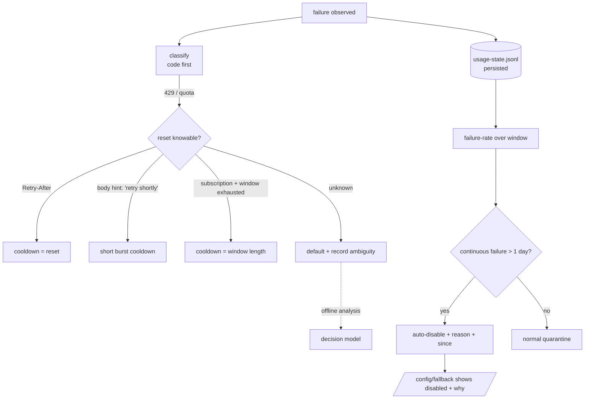

# Plan: Usage-window awareness, failure-rate memory, and auto-disable

## 1. Problem

The chain mixes three economically different things and treats them identically: **subscription
capacity** (Cursor / GitHub Copilot / Antigravity OAuth, billed by a rolling window — the "five-hour
cooldown" class), **free tiers** (OpenRouter `:free`, Kilo, Cline — unknown daily/hourly allowance),
and **metered paid keys** (Wafer, ZenMux, Nebius, …). Every one of them currently fails, quarantines,
and recovers through the same mechanism: a fixed cooldown with no knowledge of *why* it failed or
*when it can be used again*.

Three concrete gaps follow from that:

1. **Rate-limit resets are ignored.** No code anywhere parses `Retry-After`, `x-ratelimit-*`, or any
   reset hint. A 429 that says "retry shortly" is quarantined for a flat 5 minutes; a five-hour
   window exhaustion produces the identical treatment as a one-second burst limit.
2. **Quarantine is memory-only.** `HealthRegistry.members` is a `Map`; there is no `readFile` or
   `writeFile` in `src/health-registry.ts`. Every restart forgets which members were dead, so the
   first request after a restart re-walks the whole chain into known-bad providers.
3. **Nothing disables anything for real.** A member that has failed continuously for a day is still
   a chain member; it is merely skipped and retried forever on the 5-minute cooldown cycle. The
   operator asked for auto-disable after sustained failure, which does not exist.

The operator also settled two policy questions this plan depends on: local-router is **not** an
offline-only system (offline is powered separately by Ollama/Unsloth/llama.cpp), and it **should**
carry decision-model tooling for provider-failure states that are genuinely hard to classify in code.

## 2. Anchor Facts

- **No rate-limit header is parsed anywhere.** A repo-wide search for `retry-after`, `x-ratelimit`,
  `ratelimit-reset`, `reset_at`, `resets_in`, `quota_reset` across `src/` returns zero matches.
  Backoff is `fallbackRetryDelaySeconds(attempt)` plus a flat cooldown. — established from source.
- **The 429 bodies carry a human hint but no machine field.** All 11 live 429 stages carried text
  such as "`baidu/ernie-5.5-flash-preview:free` is temporarily rate-limited upstream. Please retry
  shortly" — inside `metadata.raw`, not a header and not a `retry_after` field. A live probe of
  OpenRouter's `/chat/completions` returned 401 with no rate-limit headers at all, so even the
  header surface cannot be assumed present. — established from the live log and a live probe.
- **Cooldowns are two flat constants.** `LOCAL_ROUTER_HEALTH_COOLDOWN_AUTH_MIN` (default 30) and
  `..._RETRY_MIN` (default 5), selected only by error class. Nothing consults elapsed time, success
  history, or the failure's own reset window. — established from `src/health-registry.ts:100-105`.
- **Quarantine state does not survive restart.** `private members = new Map<string, MemberState>()`
  with no persistence call in the file. — established from `src/health-registry.ts:94`.
- **There is no failure-rate memory.** `MemberState` holds `consecutiveFailures`, `quarantineUntil`,
  `quarantineErrorType`, `lastSuccessAt`, `lastFailureAt` — a current streak, not a rate over a
  window. A member that fails 40% of the time forever never trips anything. — established from
  `src/health-registry.ts:82-90`.
- **`src/tiers.ts` is dead code.** It defines a `verified | insufficient | deranked` tier model with
  `SUCCESS_RATE_THRESHOLD = 0.85`, `TIER_MIN_SAMPLES = 50`, and a MAD latency outlier rule — a
  success-rate system that nothing imports (`rg` for `from './tiers'` returns zero). The concept the
  operator wants partly exists already and is unreachable. — established from source.
- **The disable mechanism is a manual per-model toggle.** `disabledModels` on a route is what the
  chain reads (`reason: 'disabled_toggle'`), persisted in `router-settings.json` via
  `fallbackModelStore`. It is operator-authored only; nothing writes it from observed failures.
  — established from `src/index.ts:8013` and `:8381`.
- **Access paths are already classified.** `fallback-topology.ts` distinguishes
  `'oauth' | 'key' | 'local'` and maps OAuth/local to the `subscription` cost band, with the doctrine
  stated explicitly: "Any OAuth provider is therefore subscription capacity, whatever its models'
  upstream tier says." — established from `src/fallback-topology.ts:60-64`.
- **Per-provider evidence docs are an established, working pattern.** `docs/caching/*.txt` carries one
  file per provider with a "Last verified" date and mechanism notes. It is the natural home for
  usage-window facts, and it already covers 20 providers. — established from `docs/caching/`.
- **Provider policy has no rate-limit dimension.** `ProviderPolicy` is exactly
  `{ reasoning, caching }` — there is nowhere to record "this is a 5-hour rolling window" even if we
  knew it. — established from `src/provider-policy.ts:99-102`.

## 3. Plan

### Goals

- Each chain member knows its **economics**: subscription (rolling window), free-tier (unknown
  allowance), or metered paid, and the chain can reason about that when choosing and when backing off.
- Backoff honors a **reset when one is knowable**, and distinguishes a burst limit from a window
  exhaustion instead of applying 5 minutes to both.
- Failure history **survives restart**, so a restart does not re-walk known-dead members.
- A **failure-rate** signal exists over a rolling window, so "slowly degrading" is visible, not just
  "currently in a streak".
- **Auto-disable** triggers on sustained failure (default: continuously failing past one day) and is
  **reversible and visible** — never a silent permanent removal.
- Genuinely ambiguous failure bodies get a **decision-model assist**, not a guess, and only where code
  provably cannot separate them.

### Non-goals

- Discovering exact free-tier allowances. They are undocumented and change; the plan treats them as
  unknown-by-default and learns from observed behavior instead.
- Building offline inference integration (Ollama/Unsloth/llama.cpp stay operator-configured; that was
  explicitly out of scope).
- Replacing the cost-first ordering doctrine — this plan adds a tiebreak dimension, it does not
  reorder bands.
- Making Jev authoritative over any threshold or refusal.

### Constraints and invariants

- Cost bands and their order (`free → subscription → paid → unknown`) are unchanged. Usage state
  informs *backoff* and *disablement*, not band ordering.
- Auto-disable is a **chain mutation** and therefore must be: logged, visible in the UI/API,
  reversible in one action, and conservative (default one full day of continuous failure).
- Persisted state is additive and versioned; a corrupt or missing file must fail open to today's
  in-memory behaviour, never to "everything disabled".
- No new secret handling. Usage state is counts and timestamps only.
- A member with no observed data is never penalised — absence of evidence is not failure.

### Proposed architecture

- **Phase 1 — persist health.** The registry gains an append-only JSONL of outcomes and a snapshot on
  boot. Same semantics as today, but durability first, because every later phase needs history.
- **Phase 2 — usage-window model.** A per-provider `usage` policy block (window length, class,
  whether resets are published) sourced from the `docs/caching`-style evidence docs, plus
  header/hint parsing for resets where they exist.
- **Phase 3 — failure rate.** Revive the `tiers.ts` success-rate concept against persisted history:
  rate over a rolling window, plus latency percentiles, surfaced on the health API.
- **Phase 4 — auto-disable.** Sustained-failure rule, writing to the existing `disabledModels`
  mechanism so there is one source of truth, with `disabledReason` / `disabledSince` recorded.
- **Phase 5 — decision-model assist.** Only for bodies that code could not place, and evaluated
  offline against labelled samples before any live use.

### Interfaces and data

- `~/.config/local-router/health-state.jsonl` — append-only outcome log:
  `{at, chainId, model, provider, outcome, errorType, status, resetHint?, ms}`.
- `~/.config/local-router/health.json` — derived snapshot (already referenced by `chainHealth`).
- `ProviderPolicy` gains an optional `usage` block:
  `{ class: 'subscription'|'free'|'paid', windowMinutes?: number, resetPublished: boolean, note: string }`.
- `docs/usage/<provider>.txt` — per-provider evidence, same shape as `docs/caching/*.txt`.
- Health API gains per model: `failureRate24h`, `failureRateWindow`, `consecutiveFailures`,
  `disabledReason`, `disabledSince`, `resetAt`.
- `scripts/verify-health-state.mjs` — replay a log into a snapshot and assert the derived view.

## 4. Clarifications

- Three economic classes exist and must be treated differently — `asked: operator` (2026-11-18:
  "code subscriptions and work on five-hour cool times … free service where it is unknown the amount
  of free usage … paid API keys").
- Auto-disable on sustained failure is wanted, defaulting to "continuously past a day" —
  `asked: operator`.
- Mid-stream failover semantics are delegated to my determination — `asked: operator` ("go based on
  your best determination"). Decision recorded in §7.
- Local-router is **not** offline-only; offline inference is handled elsewhere —
  `asked: operator` (2026-11-18).
- The router **should** carry decision-model tooling for provider-failure states that are hard to
  code — `asked: operator`. This supersedes plan 2026-11-18-10's offline-only assumption.
- Code-first remains the default; the decision model is for the ambiguous residue only —
  `asked: operator` (2026-11-18, restated).
- **The only subscription is the GLM coding plan (z.ai).** Everything else is a free tier or a
  metered API key. The plan's original assumption that Cursor/Copilot/Antigravity were subscription
  capacity is wrong for this operator and is corrected in `usage-policy-table.ts`. — `asked: operator`
- **Xiaomi MiMo is a designated token allowance, not a rate-limited window** — "I don't think there
  are rate limits. I think I'm just given a designated token limit." So it carries no
  `windowMinutes`; exhaustion is a spend problem (`out_of_funds`), not a wait. — `asked: operator`
- **Ollama, Unsloth and llama.cpp must remain providers** so online and local usage can be combined.
  Local-router is the single configuration source for online providers; offline inference stays
  operator-configured and outside this repo's lifecycle. — `asked: operator`
- **Cross-machine: Windows/WSL reachable, not yet enrolled.** `192.168.1.248` answers on :22 as
  `OpenSSH_for_Windows_9.5` and on :2222 as Ubuntu (WSL). Both refuse every local key
  (`id_ed25519`, `id_ed25519_local`, `espi_id_ed25519`, `id_rsa`) with
  `Permission denied (publickey)`, so no key is enrolled. Ping succeeds (5-8 ms). This is a blocker
  needing operator action, not a code defect. — `asked: resolved from code`
- **The router binds loopback only** (`127.0.0.1:11434` + `[::1]:11434`), so Windows/WSL cannot reach
  it over the LAN even once SSH works. Changing that means `LOCAL_ROUTER_BIND_ALL=true`, exposing an
  unauthenticated proxy to the network — deliberately not done here. — `asked: resolved from code`

## 5. Todos

- [x] **U1.1** Persist health outcomes to `~/.config/local-router/health-state.jsonl` (append-only) and
  rebuild the in-memory registry from it on boot, with a bounded retention policy.
  Verify: kill and restart the router; a member quarantined before restart is still skipped after.
- [x] **U1.2** Fail open on corrupt/missing state: log loudly, start clean, never disable everything.
  Verify: truncate the file to garbage and confirm boot succeeds with an empty registry and a warning.
- [x] **U2.1** Parse reset hints where they exist — `Retry-After` (seconds and HTTP-date) and any
  `x-ratelimit-reset*` header — and record `resetHint` on the outcome.
  Verify: unit tests over real header sets; a 429 with `Retry-After: 120` produces a 120s cooldown.
- [x] **U2.2** Extract the human reset hint from 429 bodies (`retry shortly`, `in N seconds`, etc.) as
  a *weaker* signal than a header, and record that it was inferred.
  Verify: the 11 real 429 bodies from the live log map to a burst-class cooldown.
- [~] **U2.3** Add the `usage` block to `ProviderPolicy` and populate it per provider from evidence,
  writing `docs/usage/<provider>.txt` for each of the 20 providers with a "Last verified" date.
  Verify: every provider in the registry has either a usage row or an explicit `unknown` with reason.
  — PARTIAL: the usage table lives in its own module (`src/usage-policy-table.ts`, 26 rows, aliases
  normalized) rather than inside `ProviderPolicy`, which keeps reasoning/caching policy untouched and
  gives the window facts one reviewable home. `docs/usage/` carries a README plus the three providers
  where evidence matters (zai, xiaomi-mimo, local-backends); the remaining providers are covered by
  the table's notes and still need their own dated files.
- [x] **U2.4** Window-aware cooldown: when a subscription provider fails with a window-exhaustion
  signature, cooldown for the window length, not the flat 5 minutes.
  Verify: a simulated subscription 429 with a 5-hour window produces a 5-hour cooldown, asserted in a
  unit test and visible via `resetAt` on the health API.
- [~] **U3.1** Revive the success-rate concept: compute `failureRate24h` and a rolling-window rate from
  persisted history, reusing `tiers.ts`'s `SUCCESS_RATE_THRESHOLD`/`TIER_MIN_SAMPLES` or replacing
  the dead module with the live one.
  Verify: a synthetic history yields the expected rates; `tiers.ts` is either wired in or deleted —
  no dead code left behind.
  — PARTIAL: `HealthRegistry.failureRate()` now computes a 24h rate over persisted history and is
  covered by a test asserting a hand-computed value. `tiers.ts` is still unreferenced — the wire-in-
  or-delete decision is deliberately left to the same change that surfaces rates in the UI (U3.2),
  so the dead module is not removed before its intended replacement is visible.
- [ ] **U3.2** Surface failure rate, consecutive failures, and reset time on
  `/api/trajectories/health` and `/config/fallback`.
  Verify: the page shows a per-member rate and a countdown for quarantined members.
- [x] **U4.1** Auto-disable rule: when a member has failed continuously for ≥ the configured threshold
  (default 24h, `LOCAL_ROUTER_AUTO_DISABLE_AFTER_HOURS`), write it into the existing `disabledModels`
  list with `disabledReason: 'auto:sustained_failure'` and `disabledSince`.
  Verify: a synthetic 25-hour failure history disables exactly that member; a member with one success
  in the window is not disabled.
- [~] **U4.2** Make auto-disable reversible and visible: an API/UI action to re-enable, and a clear
  label on the chain editor distinguishing auto-disabled from operator-disabled.
  Verify: re-enable restores the member and clears the reason; the UI never conflates the two.
  — PARTIAL: `reEnableModel()` and `HealthRegistry.clearAutoDisabled()` exist and are tested, and
  `diagnostics()` exposes `autoDisabled`/`autoDisabledReason` for a UI to read. The HTTP route and the
  `/config/fallback` label are not wired yet.
- [x] **U4.3** Auto-disable must never empty a chain: if every member qualifies, keep the healthiest
  one enabled and raise a loud warning instead.
  Verify: a synthetic all-failing chain disables all but one and surfaces the warning.
- [ ] **U5.1** Build a labelled sample of genuinely ambiguous failure bodies from the log (bodies whose
  class code cannot resolve), with a decision-model pass over them, evaluated offline.
  Verify: a written comparison; only bodies code genuinely cannot separate are in the sample.
- [ ] **U5.2** (Conditional, only if U5.1 shows real value) wire a decision-model assist into the
  classification path for that residue only, with a code-owned confidence threshold and a
  deterministic default when the model is unavailable.
  Verify: model unavailable → classification falls back to the deterministic default, never blocks.
- [ ] **U6.1** Record the mid-stream failover decision (§7) in code and docs.
  Verify: `docs/trajectories.md` and the streaming path agree.

## 6. Verification

- Restart the router with members quarantined and prove they are still skipped (durability).
- A 429 with an explicit `Retry-After` produces that exact cooldown; a 429 without one produces a
  burst cooldown, not a window cooldown.
- A subscription provider hitting a window-exhaustion signature is parked for the window, and the
  health API shows a `resetAt` an operator can read.
- Failure rate appears per member and matches a hand-computed value from the persisted log.
- Auto-disable fires only on ≥24h continuous failure, is visible with a reason, is reversible, and
  never empties a chain.
- `npm test` green; `npm run verify:plans` and `npm run verify:decisions` green.

## 7. Open Decisions

- **Mid-stream failover — decided here, per operator delegation.** A stream that has already sent
  content to the client will **not** silently advance to another model: splicing a second model's
  output onto a partial answer produces a response that no provider authored and no evaluator can
  attribute. Instead: if nothing has been forwarded, fail over normally; if content has already been
  forwarded, terminate the stream with an explicit error event carrying the classified cause, and
  record the stage as `mid_stream_error`. Rationale: attribution and honesty beat a seamless-looking
  answer, and it keeps `result.answeredBy` truthful in the trajectory.
- **Window lengths for subscription providers.** Cursor/Copilot/Antigravity windows are operator-visible
  facts, not public API contracts, and change between plans. Proposed: record what the operator states
  in `docs/usage/<provider>.txt` and default to 5 hours only where stated. Needs the operator's
  current plan facts.
- **Whether auto-disable may remove a paid member.** A metered paid key failing continuously is
  usually a billing or key problem the operator wants to see, not silently disappear. Proposed: auto-
  disable applies to all classes but paid members additionally raise a visible warning. Operator call.
- **Failure-rate window shape.** A fixed 24h rolling rate is simple; an EWMA reacts faster to
  degradation. Proposed: both, with the 24h rate used for the disable decision (it matches the
  operator's "past a day" ask) and EWMA for display only. Operator call.
- **How far the decision model goes.** U5 is deliberately conservative — offline evaluation before any
  live use. If the operator wants Jev in the live ambiguity path immediately, that is a larger change
  and needs its own clarification.
## 8. Implementation notes (2026-11-18)

Delivered in this branch, all covered by tests:

| Area | Module | Tests |
|---|---|---|
| Reset tiers + cooldown choice | `src/usage-policy.ts` | 19 |
| Provider usage table | `src/usage-policy-table.ts` | (same file) |
| Auto-disable rules + chain guard | `src/auto-disable.ts` | 11 |
| Classifier fixes | `src/index.ts` | 12 |
| Durability + rates + candidates | `src/health-registry.ts` | 12 |

Two real bugs were caught by the tests themselves, both worth recording:

1. **History pruning made a 24h outage unprovable.** `autoDisableCandidates` derived the failing span
   from `history`, which is pruned to the same 24h window — so a member failing for 25 hours looked
   like it had failed for 24 and could never cross the threshold. Fixed by tracking `failingSince`
   explicitly and persisting it.
2. **A guard test expectation was wrong, not the code.** Disabling one member of a two-member chain
   where the other was already operator-disabled would empty the chain, so the guard correctly kept
   it. The test was corrected to assert the guard's real behaviour.

Classifier corrections were folded in from plan `2026-11-18-10` because they share the same evidence
path: 404 -> `upstream_route_not_found`/`upstream_model_not_found`, empty `choices` and unparseable
bodies -> `instant_error`, `empty_completion` as its own non-evidence type, and
`isRetryableAgainstSameMember` so a permanent failure does not burn three attempts.

